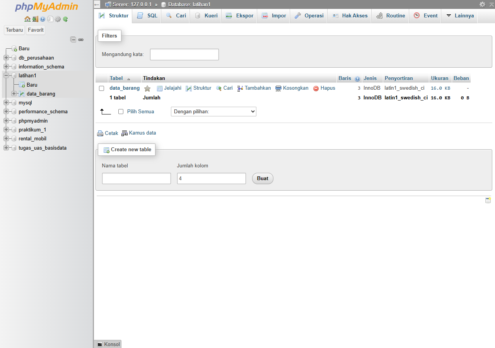
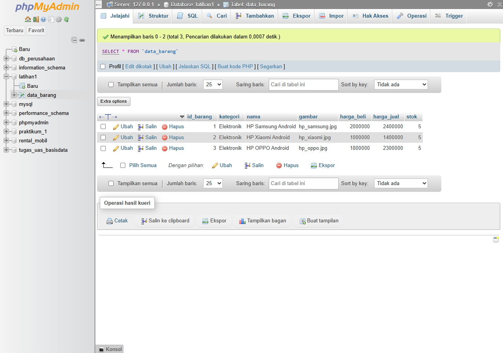
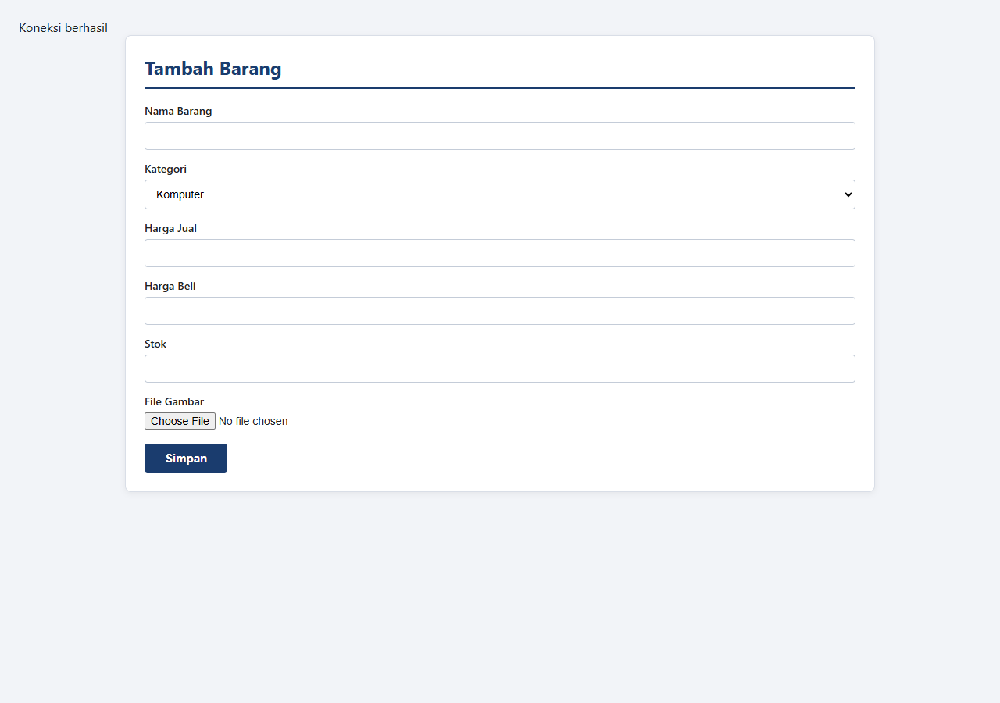
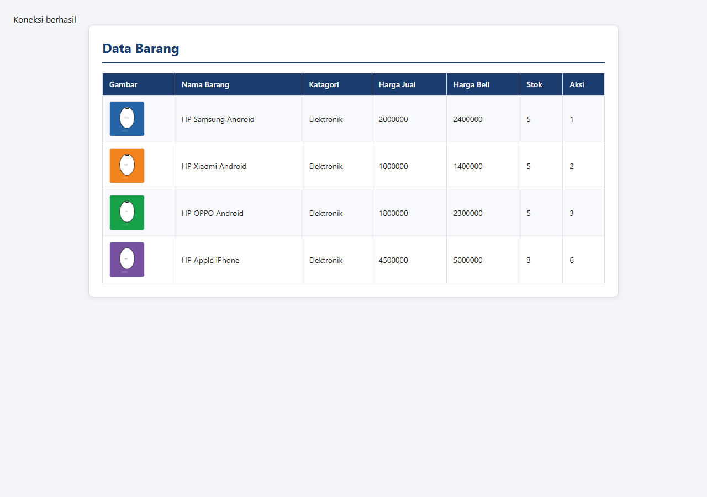
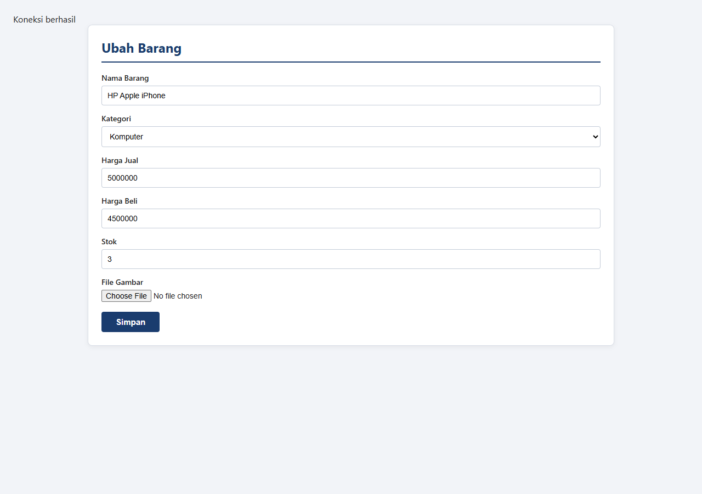
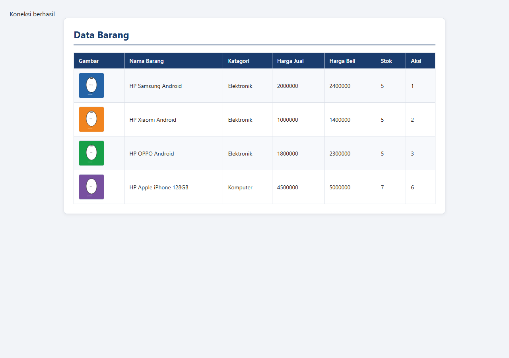
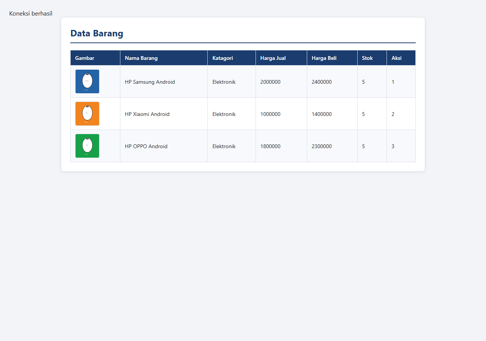

# lab8_php_database — PHP dan Database MySQL (CRUD)

**Mata Kuliah:** Pemrograman Web (OBE)
**Modul:** Praktikum 8 — PHP dan Database MySQL
**Nama:** Rafif Mizanurohman
**NIM:** 312510377
**Kelas:** I252A

## Tujuan Praktikum

1. Memahami konsep dasar Database.
2. Memahami konsep dasar CRUD menggunakan PHP.
3. Membuat program CRUD sederhana menggunakan PHP.

## Perangkat

| Komponen | Keterangan |
|---|---|
| Laptop/PC | Windows, browser Chrome/Edge |
| Editor | Visual Studio Code |
| Web server | Apache (XAMPP) |
| PHP | PHP 8.2.12 (XAMPP), ekstensi `mysqli` |
| Database | MySQL Server (XAMPP), database `latihan1` |
| Pengelola database | phpMyAdmin (`http://localhost/phpmyadmin/`) |
| Pengujian | Playwright/Chromium headless (35 pemeriksaan otomatis) |

## Struktur File

```
lab8_php_database/
├── koneksi.php           # koneksi ke database latihan1 (Read: uji koneksi)
├── index.php             # Read — menampilkan seluruh data barang
├── tambah.php            # Create — form tambah + upload gambar
├── ubah.php              # Update — form ubah + upload gambar baru
├── hapus.php             # Delete — menghapus data berdasarkan id
├── style.css             # tampilan seluruh halaman (ditulis sendiri, modul tidak menyertakannya)
├── gambar/               # folder gambar barang (hp_samsung.jpg, hp_xiaomi.jpg, hp_oppo.jpg, …)
├── screenshots/          # screenshot hasil pengujian
├── hasil_pengujian.txt   # rekapan 35 pemeriksaan otomatis
└── README.md
```

## Cara Menjalankan (sesuai modul)

1. Buka **XAMPP Control Panel**, klik **Start** pada layanan **Apache** dan **MySQL**.
2. Salin folder `lab8_php_database` ke docroot web server: `C:\xampp\htdocs\`.
3. Buka browser: `http://localhost/lab8_php_database/`
4. Pastikan database `latihan1` sudah dibuat (langkah di bawah).

> Jangan membuka file PHP dengan klik ganda — browser akan menampilkan kode mentah,
> bukan hasil eksekusi. Selalu akses lewat web server.

---

## Langkah Kerja dan Hasil

> Seluruh screenshot diambil dari browser headless (Playwright/Chromium) dengan interaksi
> nyata: mengisi form, memilih file gambar, menekan tombol **Simpan**. Seluruh alur CRUD
> diuji otomatis: **35 pemeriksaan, semuanya PASS** (rincian di bagian *Hasil Pengujian Otomatis*).

### Langkah 1 — Menjalankan MySQL Server

MySQL dijalankan dari XAMPP Control Panel (Gambar 8.1 pada modul). Apache dan MySQL
harus berjalan bersamaan karena aplikasi membutuhkan web server untuk mengeksekusi PHP
dan MySQL server untuk menyimpan data. phpMyAdmin diakses lewat `http://localhost/phpmyadmin/`.

### Langkah 2 — Membuat Database `latihan1` dan Tabel `data_barang`

Query yang dijalankan lewat tab **SQL** phpMyAdmin (persis modul):

```sql
CREATE DATABASE latihan1;

CREATE TABLE data_barang (
  id_barang int(10) auto_increment Primary Key,
  kategori varchar(30),
  nama varchar(30),
  gambar varchar(100),
  harga_beli decimal(10,0),
  harga_jual decimal(10,0),
  stok int(4)
);

INSERT INTO data_barang (kategori, nama, gambar, harga_beli, harga_jual, stok)
VALUES ('Elektronik', 'HP Samsung Android', 'hp_samsung.jpg', 2000000, 2400000, 5),
('Elektronik', 'HP Xiaomi Android', 'hp_xiaomi.jpg', 1000000, 1400000, 5),
('Elektronik', 'HP OPPO Android', 'hp_oppo.jpg', 1800000, 2300000, 5);
```

Database `latihan1` dan tabel `data_barang` berhasil dibuat:



Tiga data contoh tersimpan di tabel (kolom `id_barang` terisi otomatis 1–3):



| id_barang | kategori | nama | gambar | harga_beli | harga_jual | stok |
|---|---|---|---|---|---|---|
| 1 | Elektronik | HP Samsung Android | hp_samsung.jpg | 2000000 | 2400000 | 5 |
| 2 | Elektronik | HP Xiaomi Android | hp_xiaomi.jpg | 1000000 | 1400000 | 5 |
| 3 | Elektronik | HP OPPO Android | hp_oppo.jpg | 1800000 | 2300000 | 5 |

### Langkah 3 — Membuat File Koneksi Database (`koneksi.php`)

```php
<?php
$host = "localhost";
$user = "root";
$pass = "";
$db   = "latihan1";

$conn = mysqli_connect($host, $user, $pass, $db);
if ($conn == false)
{
    echo "Koneksi ke server gagal.";
    die();
} else echo "Koneksi berhasil";
?>
```

`mysqli_connect()` menerima host, user, password, dan nama database. Bila koneksi gagal
program berhenti dengan pesan *"Koneksi ke server gagal."*; bila berhasil pesan
*"Koneksi berhasil"* ditampilkan — sesuai instruksi modul, perintah `echo` pada `else`
di-uncomment untuk menguji koneksi.

**Hasil uji koneksi** (`http://localhost/lab8_php_database/koneksi.php`):


Karena `index.php`, `tambah.php`, dan `ubah.php` semuanya memakai `include koneksi.php`,
pesan *"Koneksi berhasil"* juga tampil di setiap halaman — bukti setiap halaman berhasil
terhubung ke database.

### Langkah 4 — Menampilkan Data (Read) — `index.php`

```php
<?php
include("koneksi.php");

// query untuk menampilkan data
$sql = 'SELECT * FROM data_barang';
$result = mysqli_query($conn, $sql);
?>
```

```php
<td>" alt="<?= $row['nama'];?>"></td>
<td><?= $row['nama'];?></td>
<td><?= $row['kategori'];?></td>
<td><?= $row['harga_beli'];?></td>
<td><?= $row['harga_jual'];?></td>
<td><?= $row['stok'];?></td>
<td><?= $row['id_barang'];?></td>
```

Query `SELECT * FROM data_barang` dijalankan dengan `mysqli_query()`, lalu hasilnya
diulang dengan `mysqli_fetch_array()` pada blok `while` untuk mengisi setiap baris tabel
HTML. Gambar diambil dari folder `gambar/` sesuai isi kolom `gambar`. Bila tabel kosong
ditampilkan baris *"Belum ada data"*.

**Hasil** — ketiga data awal tampil beserta gambarnya:


### Langkah 5 — Menambah Data (Create) — `tambah.php`

Form memakai `method="post"` dan `enctype="multipart/form-data"` agar file gambar bisa
diunggah. Saat tombol **Simpan** ditekan, PHP memproses data di bagian atas file:

```php
if (isset($_POST['submit']))
{
    $nama = $_POST['nama'];
    $kategori = $_POST['kategori'];
    $harga_jual = $_POST['harga_jual'];
    $harga_beli = $_POST['harga_beli'];
    $stok = $_POST['stok'];
    $file_gambar = $_FILES['file_gambar'];
    $gambar = null;
    if ($file_gambar['error'] == 0)
    {
        $filename = str_replace(' ', '_',$file_gambar['name']);
        $destination = dirname(__FILE__) .'/gambar/' . $filename;
        if(move_uploaded_file($file_gambar['tmp_name'], $destination))
        {
            $gambar = $filename;
        }
    }
    $sql = 'INSERT INTO data_barang (nama, kategori,harga_jual, harga_beli, stok, gambar) ';
    $sql .= "VALUE ('{$nama}', '{$kategori}','{$harga_jual}', '{$harga_beli}', '{$stok}', '{$gambar}')";
    $result = mysqli_query($conn, $sql);
    header('location: index.php');
}
```

Alur pemrosesan:

1. `$_POST['nama']` dsb. mengambil isi form; `$_FILES['file_gambar']` mengambil file unggahan.
2. `move_uploaded_file()` memindahkan file dari lokasi sementara ke folder `gambar/`
   (spasi pada nama file diganti `_` dengan `str_replace()`).
3. `INSERT INTO data_barang … VALUE (…)` menyimpan baris baru — **Create**.
4. `header('location: index.php')` mengembalikan pengguna ke daftar data.

**Form tambah:**



**Setelah mengisi form** (nama *HP Apple iPhone*, kategori Elektronik, harga jual 5000000,
harga beli 4500000, stok 3, file `hp_apple.jpg`) dan menekan **Simpan** — data ke-4
langsung tampil di index dengan gambar hasil unggahan:



### Langkah 6 — Mengubah Data (Update) — `ubah.php`

Halaman `ubah.php?id=…` menerima id dari URL (`$_GET['id']`), mengambil data lama dengan
`SELECT`, lalu menampilkannya kembali pada form (`value="…"`). Saat **Simpan** ditekan:

```php
$sql = 'UPDATE data_barang SET ';
$sql .= "nama = '{$nama}', kategori = '{$kategori}', ";
$sql .= "harga_jual = '{$harga_jual}', harga_beli = '{$harga_beli}', stok = '{$stok}' ";
if (!empty($gambar))
    $sql .= ", gambar = '{$gambar}' ";
$sql .= "WHERE id_barang = '{$id}'";
$result = mysqli_query($conn, $sql);
header('location: index.php');
```

Query `UPDATE … WHERE id_barang = …` hanya mengubah baris yang bersangkutan. Kolom
`gambar` hanya ikut diubah bila pengguna memilih file baru (`!empty($gambar)`), sehingga
lama tetap terpakai bila kolom file dibiarkan kosong. Fungsi bantu `is_select()` membuat
opsi `<select>` kategori memilih otomatis sesuai data lama.

**Form ubah (data lama sudah terisi):**



**Setelah diubah** (nama → *HP Apple iPhone 128GB*, stok → 7) — perubahan langsung
terlihat di index:



### Langkah 7 — Menghapus Data (Delete) — `hapus.php`

```php
<?php
include_once 'koneksi.php';
$id = $_GET['id'];
$sql = "DELETE FROM data_barang WHERE id_barang = '{$id}'";
$result = mysqli_query($conn, $sql);
header('location: index.php');
?>
```

`hapus.php` hanya memproses: mengambil `id` dari URL, menjalankan `DELETE … WHERE
id_barang = …`, lalu langsung kembali ke index — tanpa tampilan HTML.

**Setelah data id=6 dihapus** — daftar kembali ke 3 baris data awal:



### Langkah 8 — Tampilan (`style.css`)

Modul memanggil `<link href="style.css">` tetapi tidak menyertakan isi CSS-nya, sehingga
file `style.css` ditulis sendiri: wadah `.container` berpusat dengan kartu putih, tabel
berpagar biru tua (`#1a3c6e`), baris selang-seling, gambar 64×64 dengan `object-fit: cover`,
serta gaya form dan tombol **Simpan**.

---

## Catatan Penyesuaian Kode

Kode ditulis **identik dengan modul** (termasuk kolom *Aksi* yang menampilkan
`id_barang`, serta pilihan kategori `is_select()` yang pada modul selalu membandingkan
`'Komputer'`). Penyesuaian yang dilakukan hanya agar program berfungsi:

| No | Penyesuaian | Alasan |
|---|---|---|
| 1 | `tambah.php` & `ubah.php`: `$gambar = $filename;` (modul: `$gambar = 'gambar/' . $filename;`) | Modul menyimpan `gambar/x.jpg` padahal `index.php` sudah menambahkan prefiks `gambar/` lagi → path ganda `gambar/gambar/x.jpg` sehingga gambar unggahan 404. Data awal tetap normal karena hanya berisi nama file polos. |
| 2 | `koneksi.php`: `else echo "Koneksi berhasil";` di-uncomment | Instruksi modul pada Langkah *Membuat file koneksi database* (untuk menampilkan pesan koneksi berhasil). |
| 3 | `style.css` ditulis sendiri | Modul memakai file tersebut tetapi tidak menyertakan isinya. |
| 4 | 3 gambar placeholder (`hp_samsung.jpg`, `hp_xiaomi.jpg`, `hp_oppo.jpg`) dibuat sendiri | Modul tidak menyertakan berkas gambar, tetapi `index.php` menampilkan kolom gambar. |

---

## Hasil Pengujian Otomatis

Seluruh aplikasi diuji dengan browser headless (Playwright/Chromium) yang menjalankan
interaksi nyata seperti pengguna: membuka halaman, mengisi form, mengunggah file, dan
menekan tombol. Hasil: **35 pemeriksaan — 35 PASS, 0 gagal** (file `hasil_pengujian.txt`),
antara lain:

- **Koneksi** — `koneksi.php` HTTP 200, menampilkan *"Koneksi berhasil"*, tanpa pesan gagal.
- **Read** — `index.php` menampilkan tepat 3 baris data awal; HP Samsung/Xiaomi/OPPO tampil;
  ke-3 gambar termuat dari folder `gambar/` (tidak ada resource 404).
- **Create** — form lengkap; setelah Simpan: redirect ke `index.php`, data ke-4 muncul,
  harga 4500000/5000000 tersimpan, 4 gambar tampil, id baru terbaca dari kolom *Aksi*.
- **Update** — form terisi data lama; setelah Simpan: nama baru & stok 7 tampil,
  data lama tidak ada lagi, redirect ke `index.php`.
- **Delete** — redirect ke `index.php`, jumlah baris kembali 3, nama terhapus.
- **phpMyAdmin** — database `latihan1` terbuka dan tabel `data_barang` menampilkan data.
- Seluruh halaman **HTTP 200 tanpa error PHP** (`Fatal error`, `Parse error`, `Warning`,
  `Notice`) dan **tanpa satu pun error JavaScript**.

Rincian lengkap ada di [`hasil_pengujian.txt`](hasil_pengujian.txt).

---

## Kesimpulan

Praktikum ini menerapkan konsep database MySQL bersama PHP untuk membangun aplikasi CRUD
sederhana pada studi kasus data barang. Database `latihan1` dan tabel `data_barang` dibuat
lewat phpMyAdmin beserta tiga data contoh. File `koneksi.php` menjadi satu-satunya tempat
pengaturan koneksi `mysqli` sehingga cukup di-`include` oleh setiap halaman. Keempat
operasi CRUD terwujud dalam empat file: `index.php` (**Read** — `SELECT` lalu ditampilkan
dengan `while`/`mysqli_fetch_array`), `tambah.php` (**Create** — `INSERT` plus
`move_uploaded_file()` untuk gambar), `ubah.php` (**Update** — `SELECT` untuk mengisi form
lalu `UPDATE … WHERE id`), dan `hapus.php` (**Delete** — `DELETE … WHERE id`), semuanya
dikembalikan ke index dengan `header('location: …')`. Pengujian otomatis browser headless
membuktikan seluruh alur berjalan **35/35 PASS** tanpa error PHP maupun JavaScript,
termasuk unggahan gambar yang tampil kembali di tabel.
